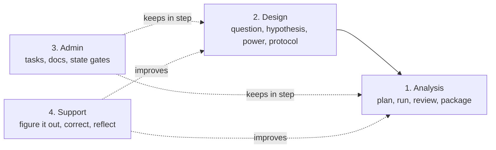
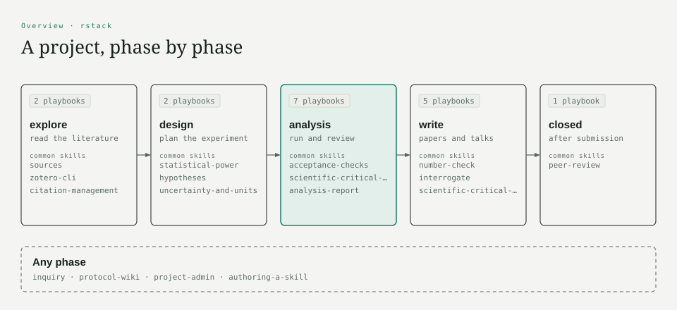

# rstack

The research counterpart to [pstack](https://github.com/cursor/plugins/tree/main/pstack). pstack helps you write less, higher quality code. rstack helps you run research projects the same way: state the question, pick a playbook, delegate deliberately, and verify every number against a file.

rstack has 21 playbooks, 24 principles and one agent (`critic`, six modes), plus 23 bundled domain skills. You never pick among them by hand: `/rstack:research-mode` reads the project's state and the task, then picks the playbook.

## The four parts



| Part | Use it when | Playbooks |
|---|---|---|
| **1. Analysis** | You have data and need figures and claims you can defend | `analysis-plan`, `analysis-run`, `analysis-review`, `package-results`, and the `critic` agent. Every figure gets its own provenance folder |
| **2. Experimental design** | You are choosing what to measure, how many, and how to test it | `experimental-design`, with `statistical-power`, `hypotheses` and `what-if-oracle` |
| **3. Project admin** | You need the project to stay organised and in sync | `project-admin` (tasks, docs, exit review, phase briefs; the only writer of `tasks.md`, mirrored to Todoist), plus `init` and `setup-research` |
| **4. Support** | The task matches no playbook, or the method itself needs fixing | `figure-it-out`, `correct`, `reflect`, and `authoring-a-skill` for managing playbooks |

Before and after those four, rstack also covers the literature loop (`literature-review`, `inquiry`, `report-bootstrap`) and raw-data intake (`raw-intake`), the write phase (`paper-preparation`, `paper-writing`, `paper-critique`, `presentation`, `peer-review`, `reviewer-response`; the user writes every paragraph), plus `reproduce`, `hillclimb`, `experiment-log` and `protocol-wiki`. The full list is in [docs/playbooks.md](docs/playbooks.md).



The full playbook map, with every skill, script and tool each playbook calls, is in [docs/overview](docs/overview/README.md).

Regenerate it with `docs/overview/regen.sh` after playbooks change.

## Principles

Every part follows a small set of principles, written as `principle-*` skills. Some apply everywhere, some to one part only. [docs/guide/06-principles.md](docs/guide/06-principles.md) lists them.

## Install these separately

rstack coaches papers and slides but never writes their prose; it does not teach, view raw files or search the web itself. It calls these tools, which install outside rstack. Without one, only the step that uses it is skipped. `/rstack:setup-research` lists which are missing.

| Tool | Used for | Where it installs | How |
|---|---|---|---|
| [`/hyperresearch`](https://github.com/jordan-gibbs/hyperresearch) | Literature search and deep research (**Literature review**, **Inquiry**) | A Python CLI in your environment, plus skills inside the folder you run it in. Run it from `~/academic-space` (the folder above `research-space`), so every project shares one vault | `pip install hyperresearch`, then `hyperresearch install` in that folder |
| [raw-viewer](https://github.com/taixuann/raw-viewer) | Inventory and look at `data/raw/` | A CLI on your PATH (`~/.local/bin/raw-viewer`) and a macOS app | Follow that repository's README; the `setup-rawviewer` skill configures a project |
| `zotero-cli` | Read and write the Zotero library (papers, annotations) | A CLI on your PATH (`~/.local/bin/zotero-cli`), installed as a `uv` tool from [zotero-mcp](https://github.com/54yyyu/zotero-mcp). rstack bundles only the skill that teaches Claude to use it. Zotero itself runs on your computer | `uv tool install zotero-mcp-server`, then see the bundled `zotero-cli` skill for its first-run check |
| `doc-coauthoring` | Writing the lab `wiki/` and `fundamental/` with you; design review (**Protocol wiki**, **Report bootstrap**) | `~/.claude/skills/doc-coauthoring/` (a skill folder, per user) | Copy the `doc-coauthoring` folder from [anthropics/skills](https://github.com/anthropics/skills) into `~/.claude/skills/` |
| [`/tutor:teach`](https://github.com/kubilaiswf/claude-tutor) | Learning a concept or paper, outside the project | A Claude Code plugin | `claude plugin marketplace add kubilaiswf/claude-tutor && claude plugin install tutor@claude-tutor` |
| [`claude-scientific-writer`](https://github.com/K-Dense-AI/claude-scientific-writer) | Posters, grants, thesis chapters (planned, not built) | A Claude Code plugin | `claude plugin marketplace add K-Dense-AI/claude-scientific-writer` |
| Todoist (MCP) | Mirror of `tasks.md` | Your host's MCP connector list | Add the Todoist connector in your host |

The optional domain skills (`neurokit2`, `lab-hardware-cad`, `analytical-method-validation`, `iso-standards-readiness`, `scholar-evaluation`) are listed with their sources in `skills/research-mode/references/skills-manifest.yaml`.

## Install

One command per host (GitHub: `taixuann/rstack`):

```bash
claude plugin marketplace add taixuann/rstack && claude plugin install rstack@rstack   # Claude Code
```

```bash
codex plugin marketplace add taixuann/rstack && codex plugin add rstack@rstack   # Codex
```

```bash
agy plugin install https://github.com/taixuann/rstack   # Antigravity (converts the Claude Code manifest)
```

Or run `bash scripts/install.sh [claude|codex|antigravity|all]` from a clone to install or update on every host present (Antigravity: clones into `~/.gemini/config/plugins/rstack`).

Claude Code leaves auto-update off for third-party marketplaces. Turn it on in `/plugin` > Marketplaces > `rstack`, or update once with `claude plugin update rstack@rstack`. In Claude Code on the web, declare rstack in the repo's `.claude/settings.json` (`extraKnownMarketplaces` and `enabledPlugins`); it loads from the second session on.

## Get started

1. Run `/rstack:setup-research` to write your research profile.
2. Start a project with `/rstack:init projects/res_<name>`.
3. Use `/rstack:research-mode` whenever you do research that needs rigor. Commands take the `rstack:` prefix.

New here? The [guide](docs/guide/README.md) walks through a first task. Stuck? Ask `/rstack:research-help`.

## A project at a glance

A project's `README.md` carries a research state: explore → design → analysis → write → closed. Work must fit the state, and a state changes only at a gate you approve.

| Folder | Holds |
|---|---|
| `data/raw/` | Raw data. Immutable |
| `docs/inputs/` | What came in: proposals, supervisor notes. Never edited |
| `docs/literature-review/` | One folder per paper, cross-paper notes, search reports |
| `docs/rstack/<state>/` | The state's tasks, documents, review and decisions |
| `analysis/` | Derived work, each number traced to a script. [How it runs](docs/analysis-runner.md) |
| `.rstack/provenance/` | One folder per figure run: inputs with hashes, scripts, environment, log, checks, review |

## Docs

- [Guide](docs/guide/README.md): a first task, step by step
- [Playbooks](docs/playbooks.md) and [the analysis runner](docs/analysis-runner.md)
- [Overview diagrams](docs/overview/README.md) and [state charts](docs/statechart/README.md) of the project states

## Maintainers

Edit `rstack/` in the `research-space` repo, then `scripts/check_plugin.py` and `scripts/publish.sh [--push]`. Never use `git subtree push`: that repo's history contains skills that cannot be redistributed.

## Credits

- **Principles.** The 24 `principle-*` skills are written by the maintainer, taixuann.
- **Domain skills.** Most of the bundled domain skills are adapted from K-Dense's [scientific-agent-skills](https://github.com/K-Dense-AI/scientific-agent-skills) and [claude-scientific-writer](https://github.com/K-Dense-AI/claude-scientific-writer) (MIT). Each adapted skill records its `upstream` and license in its own front matter; `LICENSE` lists the rest (zotero-mcp, Anthropic's `skill-creator`, Pele).
- **Workflow and modes.** Adapted from pstack (cursor/plugins, MIT License, (c) 2026 Lauren Tan).
