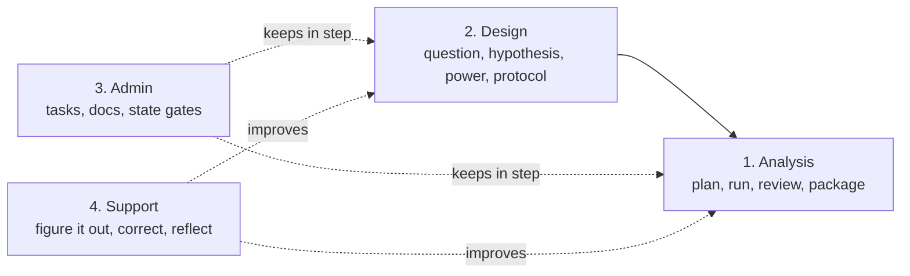

# rstack

The research counterpart to [pstack](https://github.com/cursor/plugins/tree/main/pstack). pstack helps you write less, higher quality code. rstack helps you run research projects the same way: state the question, pick a playbook, delegate deliberately, and verify every number against a file.

rstack has 21 playbooks, 20 principles and one agent (`critic`), plus 21 bundled domain skills. You never pick among them by hand: `/rstack:research-mode` reads the project's state and the task, then picks the playbook.

## The four parts



| Part | Use it when | Playbooks |
|---|---|---|
| **1. Analysis** | You have data and need figures and claims you can defend | `analysis-plan`, `analysis-run`, `analysis-review`, `package-results`, and the `critic` agent. Every figure gets its own provenance folder |
| **2. Experimental design** | You are choosing what to measure, how many, and how to test it | `experimental-design`, with `statistical-power`, `hypotheses` and `what-if-oracle` |
| **3. Project admin** | You need the project to stay organised and in sync | `task-tracking` (the only writer of `tasks.md`, mirrored to Notion), `project-docs`, `state-review`, plus `init` and `setup-research` |
| **4. Support** | The task matches no playbook, or the method itself needs fixing | `figure-it-out`, `correct`, `reflect`, and `authoring-a-skill` for managing playbooks |

Before and after those four, rstack also covers the literature loop (`literature-review`, `inquiry`, `proposal-synthesis`) and raw-data intake (`raw-intake`), plus anytime tools (`investigation`, `reproduce`, `prototype`, `hillclimb`). The full list is in [docs/playbooks.md](docs/playbooks.md).

## Principles

Every part follows a small set of principles, written as `principle-*` skills. Some apply everywhere, some to one part only. [docs/guide/06-principles.md](docs/guide/06-principles.md) lists them.

## Works with

rstack does not write papers, teach, or view raw files. It names the tools that do:

| For | Use |
|---|---|
| Writing: papers, slides, posters, grants, citations | [`claude-scientific-writer`](https://github.com/K-Dense-AI/claude-scientific-writer) |
| Learning: understand a paper or method, quizzes | `/tutor:teach` |
| Raw instrument data: inventory and look at `data/raw/` | [raw-viewer](https://github.com/taixuann/raw-viewer) |
| Papers and notes | Zotero (`scripts/zotero_snapshot.py`) |
| Design state: full-information design review, and filling the lab `wiki/` (**Protocol wiki**) | `doc-coauthoring` (Anthropic skill): install it before the design state |

## Install

```bash
bash scripts/install.sh   # Claude Code, Codex and Antigravity, whichever are present
```

Or by hand in Claude Code:

```bash
claude plugin marketplace add taixuann/rstack
claude plugin install rstack@rstack
```

Claude Code leaves auto-update off for third-party marketplaces. Turn it on in `/plugin` > Marketplaces > `rstack`, or update once with `claude plugin update rstack@rstack`. In Claude Code on the web, declare rstack in the repo's `.claude/settings.json` (`extraKnownMarketplaces` and `enabledPlugins`); it loads from the second session on.

## Get started

1. Run `/rstack:setup-research` to write your research profile.
2. Start a project with `/rstack:init projects/res_<name>`.
3. Use `/rstack:research-mode` whenever you do research that needs rigor. Commands take the `rstack:` prefix.

New here? The [guide](docs/guide/README.md) walks through a first task. Stuck? Ask `/rstack:research-help`.

## A project at a glance

A project's `README.md` carries a research state: explore → design → progressing → ready-for-publish → closed. Work must fit the state, and a state changes only at a gate you approve.

| Folder | Holds |
|---|---|
| `data/raw/` | Raw data. Immutable |
| `docs/inputs/` | What came in: proposals, supervisor notes. Never edited |
| `docs/literature-review/` | One folder per paper, cross-paper notes, search reports |
| `docs/rstack/<state>/` | The state's tasks, documents, review and decisions |
| `analysis/` | Derived work, each number traced to a script. [How it runs](docs/analysis-runner.md) |
| `.rstack/provenance/` | One folder per figure run: inputs with hashes, scripts, environment, log, checks, review |

## Docs

- [Guide](docs/guide/README.md): a first task, step by step
- [Playbooks](docs/playbooks.md) and [the analysis runner](docs/analysis-runner.md)
- [State chart](docs/statechart/README.md) of the project states

## Maintainers

Edit `rstack/` in the `research-space` repo, then `scripts/check_plugin.py` and `scripts/publish.sh [--push]`. Never use `git subtree push`: that repo's history contains skills that cannot be redistributed.

## Credits

The workflow skills and mode structure are adapted from pstack (cursor/plugins, MIT License, (c) 2026 Lauren Tan). Bundled domain skills come from K-Dense scientific-agent-skills, zotero-mcp and the former openscience-adapter; see each skill's license.
