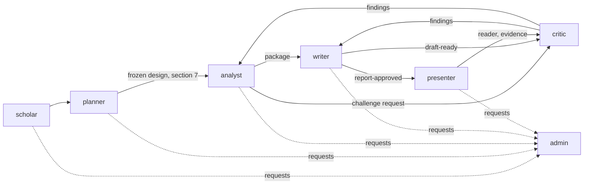

# Setting up role bots

One project can be worked by several bots at once, one per role. This folder is the setup guide: each role file tells a bot what to read, which playbooks are its own, which paths it may write, and who it hands work to. The playbooks themselves live in `skills/research-mode/playbooks/`; nothing here changes how they run.

## Install

```bash
scripts/install.sh            # Claude Code, Codex and Antigravity, whichever are present
```

Then open one session per role, in the project folder, and give it the start text at the bottom of its role file.

## The roles

| Role | Playbooks | Phases |
|---|---|---|
| [admin](admin.md) | project-admin, playbook-control | any |
| [scholar](scholar.md) | literature-review, inquiry (explore mode), wiki-mode | explore |
| [planner](planner.md) | report-init, experimental-design, experiment-log, inquiry (design mode) | explore end, design, analysis (log) |
| [analyst](analyst.md) | raw-intake, analysis-plan, analysis-run, analysis-review (compare and accept), hillclimb, reproduce, package-results | analysis |
| [critic](critic.md) | paper-critique, peer-review, analysis-review (challenge) | analysis, write, exit reviews |
| [writer](writer.md) | paper-preparation, paper-writing, reviewer-response | write, closed |
| [presenter](presenter.md) | presentation | write |

All 21 playbooks are covered once. `inquiry` is split by mode, so no file has two writers.

## Rules every role follows

1. **One writer per file.** A bot writes only the paths under its "May write". The layout standard (`skills/research-mode/references/layout.md`) is the reference.
2. **Only admin writes `docs/rstack/tasks.md`**, `README.md`, `AGENTS.md` and `CLAUDE.md`.
3. **Handoffs go through `docs/rstack/requests.tsv`**, append-only, tab-separated:

   | date | from | to | kind | text | status |
   |---|---|---|---|---|---|
   | 2026-11-22 | planner | admin | task | add analysis tasks for E1 after freeze | open |

   `kind` is `task`, `phase`, `doc` or `review`. The recipient sets `status` to `done` when it has acted. Read the rows addressed to you at the start of every session.
4. **The user decides.** Gates, phase changes, accepted fixes and every manuscript line stay the user's; bots stop at them.
5. **Decisions** of long or unattended work go to `docs/rstack/decisions.tsv` (`show-me-your-work`).

## Handoffs


