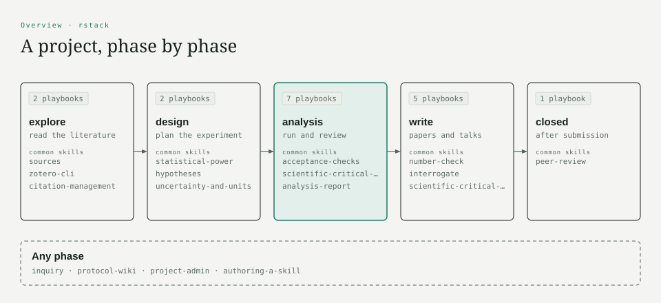
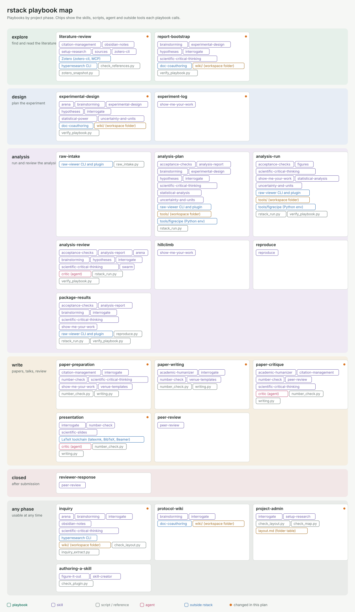

# Overview diagrams

Static pictures that show how rstack fits together. They are regenerated from the plugin, so they do not drift. State machines that TLC checks are in [../statechart/](../statechart/README.md).

`phase-overview.svg` (and `.html`): the five phases in order, how many playbooks each owns and its most-used skills, drawn in the `/diagram-design:diagram-design` look with the rstack profile (`~/.diagram-design/profiles/rstack.md`). The detail is below.

`playbook-map.svg` (and `.png`): playbooks by phase, with the skills, scripts, agent and outside tools each one calls. Rebuild everything with `./regen.sh`; it reads the playbooks and writes the files here. `regen.sh` also builds the interactive page `map2.html` in a temp folder.
