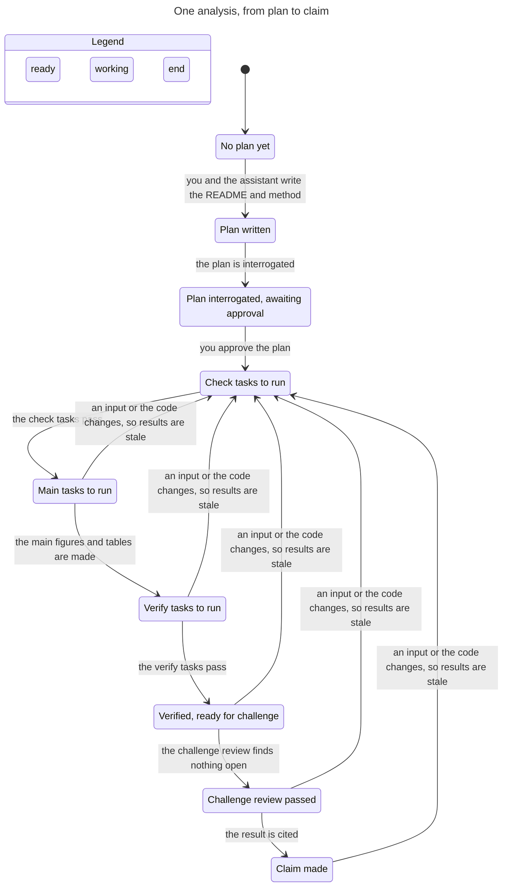

# Analysis workflow statechart

How one analysis moves from plan to claim. TLC checked `AnalysisStates.tla`: 9 states, 14 steps, all rules hold, no deadlock. Removing the check guard from the main step made `NoMainBeforeCheck` fail with a 4-step path, so the rules do catch a skipped stage.

**Rules the model checks**
- No task runs before the plan is approved.
- No main task before the check tasks are done.
- No verify task before the main tasks are done.
- The challenge review needs the verify tasks done.
- A result is cited only after the challenge review.

**What the model leaves out.** One task per group (the real README has many). The re-run case: an input or the code changing sends every result back to "Check tasks to run" and withdraws the claim. A failed check, which the plan handles as an exclusion or a recorded deviation. The "nothing more happens" step after a claim.

**Make it again:** from this folder, `../../skills/statechart/scripts/statechart AnalysisStates.tla --config AnalysisStates.cfg --view analysis.view.mjs --out <new folder>`.

