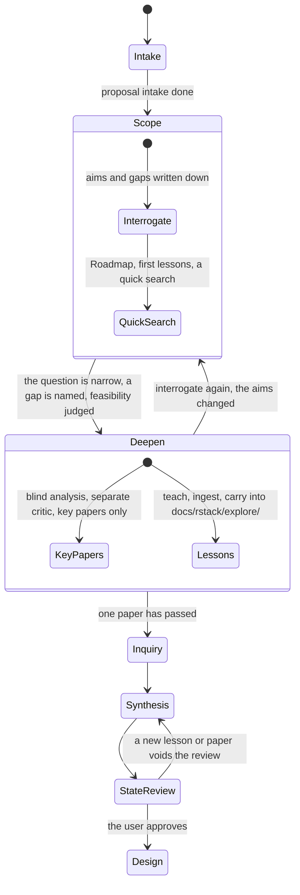

# Explore: scope, then deepen (draft, not yet applied to the playbooks)

TLC checked `ExploreV3.tla` (one lesson, two papers): 276 states, 1162 steps, all rules hold, no deadlock. It supersedes `EXPLORE.md`.

**Rules the model checks**
- Roadmap, paper registration and inquiry need an `interrogate` first.
- Blind analysis, the critic and inquiry run only on a scoped question. Interrogating again clears the scope.
- A lesson needs a Roadmap. A new lesson or reviewed paper voids the state review; exit needs a fresh one.

**Learning in the task list.** `tasks.md` gets a `Learning` heading in every state. Each line is one Roadmap item that the state needs, written as `Learn: <item> (Roadmap)`. It is ticked when the item's `## Understanding` rows reach the level its Enough-means line asks for, so Notion stays the source of truth and `tasks.md` only mirrors it. `make-me-roadmap` adds the lines when it runs at state entry; `evaluate-my-understanding` is the only thing that ticks them. `scripts/sync_readme_tasks.py` then shows the open ones in the README block with no change.
