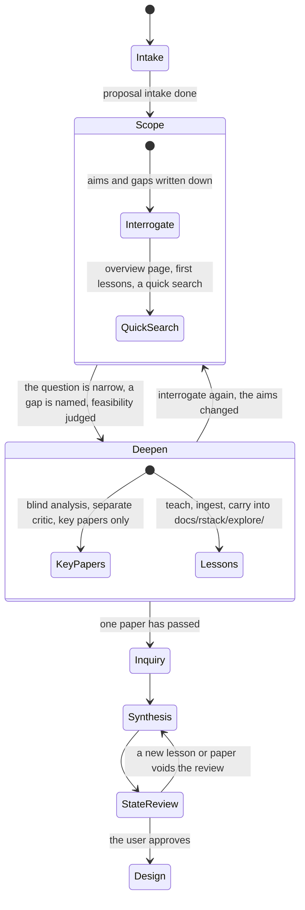

# Explore: scope, then deepen (draft, not yet applied to the playbooks)

TLC checked `ExploreV3.tla` (one lesson, two papers): 276 states, 1162 steps, all rules hold, no deadlock. It supersedes `EXPLORE.md`.

**Rules the model checks**
- The overview page, paper registration and inquiry need an `interrogate` first.
- Blind analysis, the critic and inquiry run only on a scoped question. Interrogating again clears the scope.
- A lesson needs the user's overview page (the model still names it `roadmap`). A new lesson or reviewed paper voids the state review; exit needs a fresh one.

**Learning in the task list.** Retired. `docs/rstack/tasks.md` (Phase > Goal > Task) no longer carries `Learn:` lines. Learning is no longer part of rstack. `ExploreV3.tla` still uses the word `roadmap` for "the overview page exists". Its logic is unchanged.
