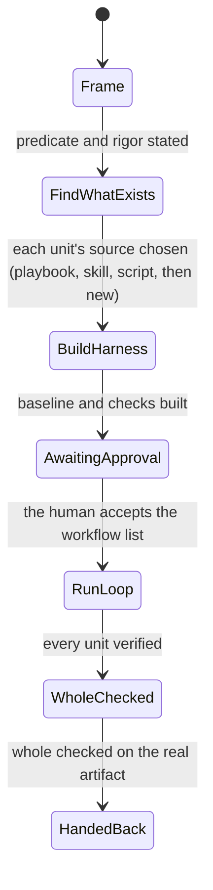

# figure-it-out statechart (draft)

TLC checked `FigureItOutStates.tla` on a task with two units: 12 states, 27 steps, all rules hold, no deadlock.

**Rules the model checks**
- The harness is built only after each unit's source is chosen.
- No unit runs before the human accepts the workflow.
- An inconclusive unit is retried and never counts as verified.
- Hand-back needs every unit verified and the whole checked.

The chart leaves out the inconclusive and retry steps, which stay inside "Run the loop".

**Make it again:** from this folder, `../../skills/statechart/scripts/statechart FigureItOutStates.tla --config FigureItOutStates.cfg --view figure.view.mjs --out <new folder>`.
