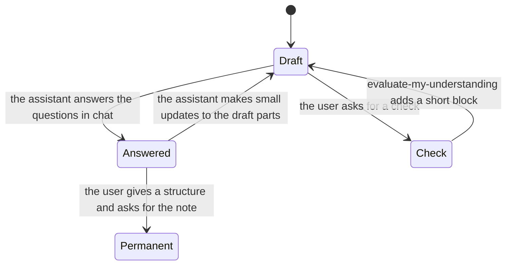

# Learning pathway (light loop)

How one topic's learning moves in Notion. Draft, literature note, permanent note. This replaces the earlier draft with a Roadmap section and Understanding rows. TLC checked `LearningStates.tla`: 17 states, 54 steps, all rules hold, no deadlock.

**Who owns each step**

| Step | Skill | Notes |
|---|---|---|
| The draft and its plan | the user | Their own words and questions |
| What is still open | `make-me-roadmap` | Reads the user's page and says in chat. Writes nothing |
| Answer | `teach`, `explain` | In chat, short, one answer for each question |
| Small updates to the draft | `teach`, `explain` | The user's structure and style. A few words or one sentence each; chat lists what changed |
| Literature note | `explain` | The assistant's block. Keeps its structure; small additions only |
| Permanent note | the user, with `teach` | The user's structure and words. One note per topic; split only when told |
| Branch | `teach` or `explain` | A new Raw page with `Parent:` and `Depth:`; depth 3 at most |
| Ask the user | `interrogate` | Interview mode |
| Understanding check | `evaluate-my-understanding` | On request. A short block at the end of the user's page |
| Ingest | `notion-llm-wiki` | One Raw page to one ingested page |
| Restate in plain words | `bro`, `in-your-own-words` | Any state; they change nothing |

**Rules the model checks**
- A literature note and a permanent note need a draft.
- The first permanent note needs an up-to-date literature note and the user's structure.
- More than one permanent note only when the user said split.

**Rules written in the skills (not model-checked)**
- Never restructure a page or make a massive edit.
- A closed Raw page is never extended; the next lesson opens a new page with `Continues:`.
- `[user]` quotes are never edited.
- Editing text that has a Notion comment deletes the thread. Notion's resolve and suggested-edit tools need a Business plan.
- Only lesson text goes to Notion, never signals or subject data.
