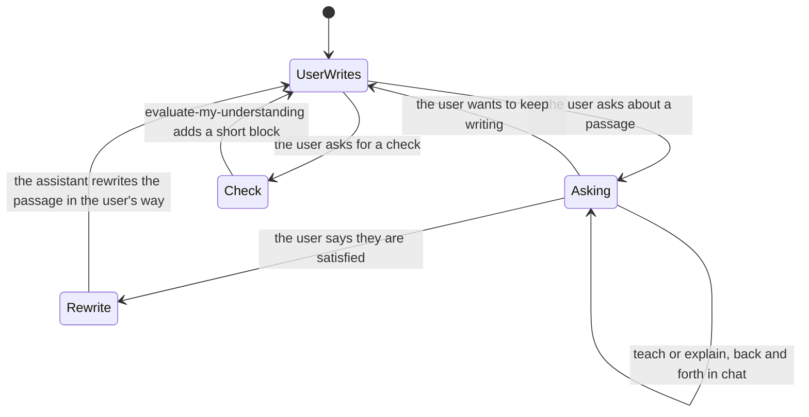

# Learning pathway (light loop)

How one topic's learning moves in Notion. The user writes the page. The assistant helps in chat. This replaces the earlier draft with a Roadmap section and Understanding rows. TLC checked the new `LearningStates.tla`: 61 states, 306 steps, all rules hold, no deadlock.

**Who owns each step**

| Step | Skill | Notes |
|---|---|---|
| The page and its plan | the user | An overview page in their own words |
| What is still open | `make-me-roadmap` | Reads the user's page and says in chat. Writes nothing |
| Answer, back and forth | `teach`, `explain` | Chat only. No page edit |
| Base knowledge block | `explain` | Optional block under the user's text, labelled `[assistant]` |
| Rewrite the passage | `teach`, `explain` | Only after the user is satisfied, in the user's way |
| Branch | `teach` or `explain` | A new Raw page with `Parent:` and `Depth:`; depth 3 at most |
| Ask the user | `interrogate` | Interview mode |
| Understanding check | `evaluate-my-understanding` | On request. A short block at the end of the user's page |
| Ingest | `notion-llm-wiki` | One Raw page to one ingested page |
| Restate in plain words | `bro`, `in-your-own-words` | Any state; they change nothing |

**Rules the model checks**
- The assistant rewrites only a page the user wrote, and only after the user is satisfied.
- A level is recorded only for a page the user wrote.
- Ingest never closes a page while a talk is open.

**Rules written in the skills (not model-checked)**
- Never edit the user's text before they say they are satisfied.
- A closed Raw page is never extended; the next lesson opens a new page with `Continues:`.
- `[user]` quotes are never edited.
- Editing text that has a Notion comment deletes the thread. Notion's resolve and suggested-edit tools need a Business plan.
- Only lesson text goes to Notion, never signals or subject data.
