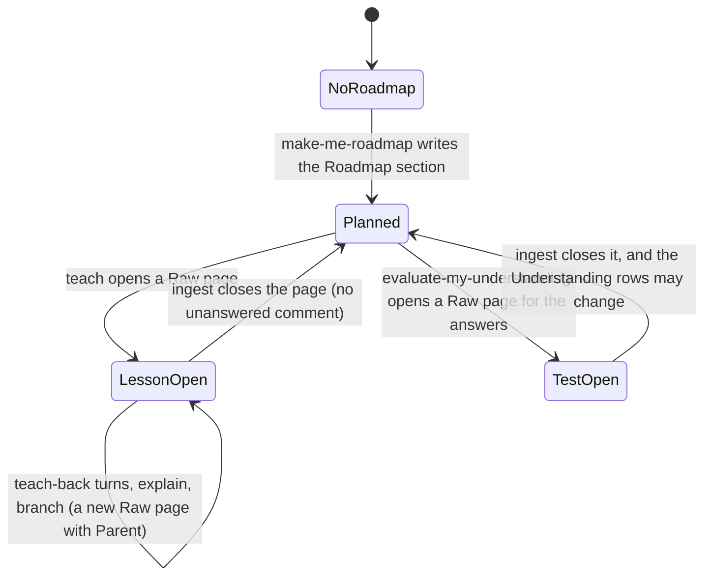

# Learning pathway statechart (draft)

How one topic's learning moves in Notion. TLC checked `LearningStates.tla`: 32 states, 100 steps, all rules hold, no deadlock. This is a draft for review. No skill has been changed to match it yet.

**Who owns each step**

| Step | Skill | Notes |
|---|---|---|
| Roadmap section on the topic MOC | `make-me-roadmap` | Edits only that section, never the index table |
| Open and extend a Raw page | `teach`, `explain` | Comments are read and answered in-thread by these two |
| Branch | `teach` or `explain` | A new Raw page with `Parent:` and `Depth:`; depth 3 at most |
| Ask the user | `interrogate` | Interview mode for the user's views and for tests |
| Understanding test | `evaluate-my-understanding` | Answers go onto a new Raw page; writes the `## Understanding` rows |
| Ingest | `notion-llm-wiki` | One Raw page to one ingested page; refuses if a comment is unanswered |
| Restate in plain words | `bro`, `in-your-own-words` | Any state; they change nothing |

**Rules the model checks**
- No lesson opens before a Roadmap section exists.
- A comment thread exists only on an open Raw page.
- Ingest never runs while a comment is unanswered.
- The understanding level changes only when a test page is ingested, so re-ingest keeps the `## Understanding` section.
- An explained level needs an ingested page that carries it.

**Rules the model does not check** (written in the skills instead)
- A closed Raw page is never extended; the next lesson opens a new page with `Continues:`.
- `[user]` quotes are never edited.
- Only lesson text goes to Notion, never signals or subject data.

**Make it again:** run the `statechart` script as in `README.md`, with `LearningStates.tla` and `LearningStates.cfg`. The raw chart has 32 states; a `view.mjs` is needed to fold it to the six states above.
