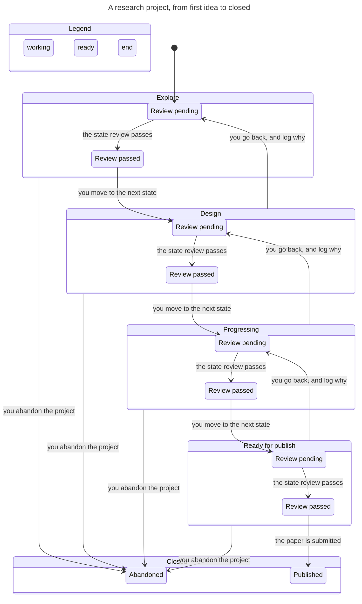

# Research lifecycle statechart

How a project moves through rstack's five states. TLC checked the model: 12 states, 26 steps, all rules hold.



**Rules the model checks**
- No analysis starts before the design is frozen (the design review sets `frozen`).
- No write-up starts before every result has a disposition (the progressing review sets `accepted`).
- A project is only published with its results accepted.
- A closed project has a reason (published or abandoned), and only a closed one does.

**What the chart leaves out.** Four steps that stay inside one chart state (for example a second review in a state whose review has already passed). Moving back clears what the later state froze or accepted, and you re-clear that gate on the way forward.

**Analysis workflow.** `ANALYSIS.md` charts the run gate and tick (check before main before verify). It was drawn before the review, accept-a-run and package steps were added, so it does not show them yet.

**Make it again**

```bash
rstack/skills/statechart/scripts/statechart \
  ResearchStates.tla --config ResearchStates.cfg --view view.mjs --out out
```

The first run installs Java and TLC through `mise`. Render the SVG with `pele@1.9.0` as in the statechart skill's `references/render.md`.


